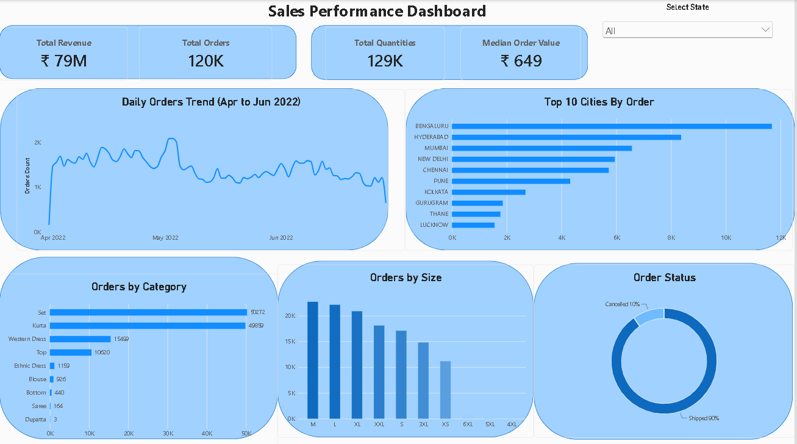

# 📊 Sales Performance Dashboard (Power BI)

An interactive Power BI dashboard analysing Amazon e-commerce sales data from Apr to Jun 2022.

## 🖼️ Dashboard Preview

## 📌 Key Metrics
- 💰 **Total Revenue:** ₹79M
- 🛒 **Total Orders:** 120K
- 📦 **Total Quantities:** 129K
- 🧾 **Median Order Value:** ₹649

## 💡 Insights
- 🏙️ Bengaluru has the most orders, followed by Hyderabad and Mumbai
- 👗 Set and Kurta make up most of the orders
- 🚚 About 90% of orders are shipped and 10% are cancelled

## ✨ Features
- 🎛️ **State slicer** to filter the whole report
- 📈 **Daily orders trend** for Apr to Jun 2022
- 🏙️ **Top 10 cities** by orders
- 🛍️ **Category and size analysis**
- ✅ **Order status** breakdown

## 🛠️ Tools Used
- Power BI Desktop
- DAX
- Excel

## ▶️ How to Use
1. Download `sales_dashboard1.pbix`
2. Open it in Power BI Desktop
3. Use the state slicer to explore the data

## 📂 Dataset
Source: https://www.kaggle.com/datasets/mdsazzatsardar/amazonsalesreport

## 👤 Author
**Ganesh**: [GitHub](https://github.com/thecodewithganesh)